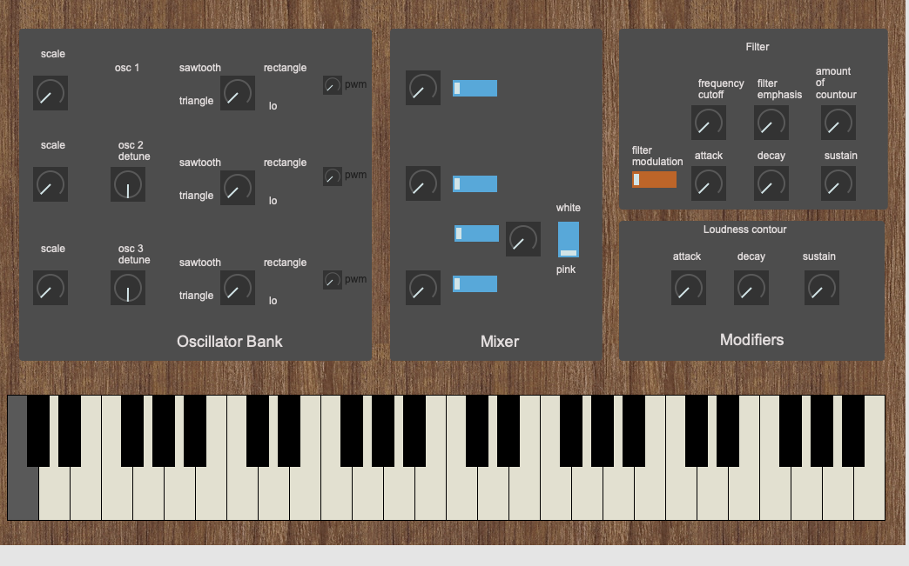
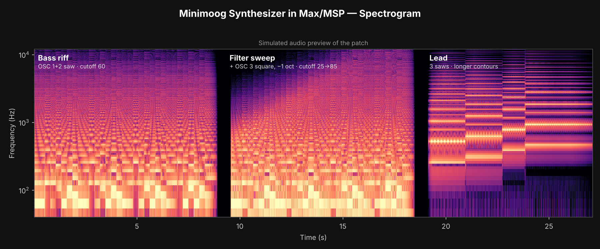

<div align="center">

# 🎹 Minimoog Synthesizer in Max/MSP
### *A funk-powered tribute to the Moog Minimoog Model D and Bernie Worrell*




*Three oscillators, a mixer with noise, a resonant filter and two contour generators, built from scratch in Max/MSP and themed after Parliament-Funkadelic.*

</div>

---

## 📖 Contents

1. [The Moog story](#the-moog-story)
2. [Bernie Worrell: the Minimoog goes funk](#bernie-worrell-the-minimoog-goes-funk)
3. [How P-Funk shaped this patch](#how-p-funk-shaped-this-patch)
4. [Hear it](#hear-it)
5. [How to run](#how-to-run)
6. [Signal flow](#signal-flow)
7. [Inside the three sections](#inside-the-three-sections)
8. [Controls and default settings](#controls-and-default-settings)
9. [Development process: problems and solutions](#development-process-problems-and-solutions)
10. [Code review and refinements](#code-review-and-refinements)
11. [Compared with the original Model D](#compared-with-the-original-model-d)
12. [Repository contents](#repository-contents)
13. [Further reading and listening](#further-reading-and-listening)
14. [Credits](#credits)

---

<a id="the-moog-story"></a>

## 🕰 The Moog story

In the 1960s, **Robert Moog** built some of the first commercial voltage-controlled synthesizers. They were *modular*: walls of separate modules (oscillators, filters, amplifiers, envelope generators) connected with patch cables. They sounded revolutionary, but they were huge, expensive and mostly confined to studios and universities.

The **Minimoog** changed that. It began as a prototype that Moog engineer **Bill Hemsath** built from spare parts, and in **1970** it became the **Minimoog Model D**: the most useful parts of the modular system, wired together inside one portable keyboard instrument. It was the first synthesizer sold in ordinary music stores, and its layout became the template for almost every synthesizer since:

```
 OSCILLATOR BANK  ──►  MIXER  ──►  MODIFIERS (filter + contours)  ──►  OUTPUT
   3 oscillators       levels       24 dB/oct ladder filter,
   range + waveform    + noise      filter contour, loudness contour
```

What gives the Model D its famous weight:

- 🔊 **Three oscillators** that drift slightly against each other, producing a thick, moving tone
- 🌊 **The ladder filter**, Moog's 4-pole (24 dB per octave) low-pass design, with an **emphasis** (resonance) control that can make it squelch, whistle or even oscillate on its own
- 📈 **Two contour generators** that shape the filter and the volume over time, which is where the "bwow" in a Moog bass comes from

The Model D was made from 1970 to 1981, has been reissued since, and remains one of the most recognisable instruments in recorded music. This project recreates its three core sections in Max/MSP: the **Oscillator Bank**, the **Mixer** and the **Modifiers**.

<a id="bernie-worrell-the-minimoog-goes-funk"></a>

## 🌈 Bernie Worrell: the Minimoog goes funk

**George Bernard "Bernie" Worrell Jr.** (1944–2016), known as *the Wizard of Woo*, was the keyboard player and musical director of **Parliament-Funkadelic**. He was a classically trained prodigy, and he was one of the earliest musicians to take the Minimoog out of the experimental world and onto the dance floor.

- 🎸 **The bass that wasn't a bass guitar.** On Parliament's **"Flash Light"** (1977, from *Funkentelechy Vs. the Placebo Syndrome*), the bass line is played on **Minimoogs**. The part was first meant for Bootsy Collins, but Bernie created the line himself on three or four connected Minimoogs, each set differently, to get a sound bigger than any single synth. "Flash Light" became one of Parliament's biggest hits.
- 🧪 **A new vocabulary.** Bernie's sliding, rubbery, squelching synth lines on songs such as **"Give Up the Funk (Tear the Roof off the Sucker)"**, **"Aqua Boogie"** and **"Knee Deep"** defined the P-Funk sound. He played the Minimoog like a lead instrument and a bass player at the same time.
- 🌍 **His influence.** The Minimoog bass sound he pioneered runs through later funk and R&B, **West Coast G-funk** (Dr. Dre's high, squelchy Moog leads on *The Chronic* trace straight back to P-Funk) and even early techno. Bernie also went on to perform with **Talking Heads**.

That mix of classical precision and wild, futuristic funk is the spirit this project is built around.

<a id="how-p-funk-shaped-this-patch"></a>

## 🛸 How P-Funk shaped this patch

**🎨 The look.** The front panel uses a **Parliament theme** as its background art, as a tribute to the band that made the Minimoog funky. The image is embedded in the patch, so the theme travels with the file.

**🎚 Stacked oscillators, like Bernie's stacked Minimoogs.** Bernie got the "Flash Light" bass by layering several Minimoogs. This patch does the same thing inside one instrument: three oscillators, each with its own **octave range**, **waveform** and **detune**, add together in the mixer. The default sound stacks two **sawtooth** oscillators with oscillator 2 tuned slightly sharp, so they beat against each other the way separate analog synths would.

**🌊 Squelch on demand.** The P-Funk sound depends on the filter moving on every note. The patch's **filter contour** is *added on top of* the cutoff knob's setting, and **emphasis** sharpens the peak, so each key press makes the filter sweep up and fall back. Turn up **Amount of Contour** and **Emphasis** for the squelchy, vocal quality of Bernie's lines, or drop the cutoff for deep, round bass.

**🎹 Played like a bass player.** It's **monophonic**, like the Model D: one note at a time, built for bass lines and leads. Release follows decay, as with the Minimoog's Decay switch, so short staccato notes stay tight while held notes ring out naturally.

### 🔦 Try a "Flash Light"-style bass

Reverb's [video breakdown of Bernie's sounds](https://www.youtube.com/watch?v=IeiTd5QWO7E) starts this bass with two sawtooth oscillators an octave apart (32′ and 16′). Bernie really used three or four Minimoogs, each set differently, and fans still debate exactly how he set them, so treat this as a starting point in the same spirit, not an exact copy:

| Section | Setting |
|---|---|
| Osc 1 | Sawtooth, range **0** (two octaves down), level 7 |
| Osc 2 | Sawtooth, range **1** (one octave down), detune **6**, level 6 |
| Osc 3 | Sawtooth, range **1**, detune **4**, level 4, **on** (the "extra Minimoog") |
| Filter | Cutoff **40–50**, Emphasis **4**, Amount of Contour **6** |
| Filter contour | Attack 0, Decay **3**, Sustain **2** |
| Loudness contour | Attack 0, Decay **3**, Sustain **8** |

Play short, bouncy notes, then sweep the cutoff while you play.

<a id="hear-it"></a>

## 🔊 Hear it



<!-- To show an in-page video player: edit this file on github.com and drag media/preview.mp4 into this spot. GitHub replaces it with a playable video. -->

🎬 [`media/preview.mp4`](media/preview.mp4) · 🔊 [`media/audio-preview.mp3`](media/audio-preview.mp3)

The preview has three parts:
1. **Bass riff:** a two-oscillator funk riff on the default settings
2. **Filter sweep:** oscillator 3 added as a square wave an octave down, with the cutoff opening slowly and more emphasis
3. **Lead:** slow notes on three saws with longer contours

### 📊 Reading the spectrogram

A spectrogram shows **time** from left to right, **frequency** from bottom to top (on a log scale, like a piano keyboard) and **loudness** as brightness. Each part of the preview shows a different part of the synth at work:

| Part | What you see | What it shows about the synth |
|---|---|---|
| **1 · Bass riff** (0–9 s) | Bright blocks below ~200 Hz that change with each note, with a dense stack of fainter lines above them that fades toward the top | The bright low blocks are the **fundamentals** of the bass notes. The stack above is the **harmonic series of the sawtooth waves**: a saw contains every harmonic, which is why it sounds so full. The fade toward the top is the **low-pass filter** at work: with the cutoff at about 1.3 kHz, the higher harmonics are reduced. |
| | Faint vertical "pulses" on every note | The **filter contour** opening on each key press and closing again, which is the "bwow" of a Moog bass, visible as a quick burst of brightness at each note's start. |
| **2 · Filter sweep** (9.5–18.5 s) | The top of the image starts dark and gradually fills with energy from left to right | The **cutoff sweep**. At the start the filter only lets the low end through. As the cutoff opens (from 25 to 85 on the dial, about 120 Hz to 7 kHz), more and more harmonics appear. This is the classic Minimoog filter sweep, drawn as a picture. |
| | A stronger, steadier low end than part 1 | **Oscillator 3** added as a square wave an octave down. A square wave only has odd harmonics, so it thickens the bottom without crowding the upper range. |
| **3 · Lead** (19–27 s) | Clear horizontal lines that step upward note by note, with almost nothing below ~250 Hz | Long held notes make each **harmonic** show as a separate line. The lines step up with the melody (C, E♭, G, B♭). The empty low end is the **octave range** at work: oscillators 1 and 2 are set an octave up, so there's no bass. |
| | A brighter band of lines around ~500 Hz–1 kHz | **Emphasis (resonance)**: the filter boosts harmonics near its cutoff, giving the vocal, "singing" quality of a Moog lead. |
| | Slight shimmer and wobble in the lines | **Detune**: the oscillators are tuned slightly apart, so their harmonics beat against each other. This is the same thickening effect Bernie got by stacking several Minimoogs. |

**Takeaways:** the picture confirms each section is doing its job. The oscillators produce rich harmonics, the filter removes the top end and moves on cue, the contours shape every note, and detune and resonance add movement and character.

> **Note:** this preview is a simulation. It was rendered offline in Python, following the patch's signal path and default settings, not recorded from Max. A recording of the patch running in Max will replace it.

<a id="how-to-run"></a>

## ▶️ How to run

1. Install [Max](https://cycling74.com/products/max) 8 or later. The free version can open and play the patch.
2. Open `Minimoog.maxpat`. It opens in Presentation mode, showing the front panel.
3. Click the speaker button (`ezdac~`) to turn on audio.
4. Play from a connected MIDI keyboard, or click the on-screen keyboard.

Every control loads a playable default when the patch opens, so it makes sound right away. To see the patching behind the panel, switch to Patching mode (Cmd/Ctrl + Alt + E).

<a id="signal-flow"></a>

## 🔀 Signal flow

```
 MIDI keyboard / on-screen kslider
        │
        ├── note number ─────────────────────────────────────────────┐
        │                                                            ▼
        │         ┌───────────── OSCILLATOR BANK (×3) ──────────────────────┐
        │         │ note + (octave × 12 − 24) → mtof → × detune → frequency │
        │         │ tri~ / saw~ / rect~(pulse width) → selector~ 3          │
        │         └───────────────────────────┬─────────────────────────────┘
        │                                     ▼
        │         ┌──────────────────── MIXER ──────────────────────────────┐
        │         │ osc 1-3: level (×~) → on/off (gate~)                     │
        │         │ noise~ / pink~ → selector~ 2 → level → on/off            │
        │         └───────────────────────────┬─────────────────────────────┘
        │                                     ▼
        │         ┌──────────────────── MODIFIERS ──────────────────────────┐
        ├─ velocity ─► filter contour (adsr~)                              │
        │         │   cutoff × (1 + 4 × amount × contour) → lores~ ◄─ emphasis
        │         │   filter bypass switch (gate~ 2)                         │
        └─ velocity ─► loudness contour (adsr~) → VCA (×~)                 │
                  └───────────────────────────┬─────────────────────────────┘
                                              ▼
                     master volume → headroom (×0.3) → stereo out + spectroscope
```

<a id="inside-the-three-sections"></a>

## 🔧 Inside the three sections

| | |
|---|---|
| **Built with** | Max 8 (MSP audio objects, Presentation mode UI) |
| **Voices** | Monophonic, like the original |
| **Sound sources** | 3 oscillators + white/pink noise |
| **Filter** | Resonant low-pass (`lores~`) with its own contour generator |
| **Envelopes** | Filter contour and loudness contour (Attack / Decay / Sustain, release follows decay) |
| **Input** | MIDI keyboard or on-screen keyboard |

### 1. Oscillator Bank

Each oscillator lives in its own copy of the `p range and frequency` subpatcher, which turns a MIDI note into a frequency:

```
frequency = mtof(note + octave × 12 − 24) × detune
```

- **Range (octave):** a 5-step dial (0–4) that shifts the oscillator from −2 to +2 octaves. It outputs whole numbers, so the oscillator always jumps in exact octaves, like the Minimoog's range switch (32′, 16′, 8′, 4′, 2′).
- **Detune (oscillators 2 and 3):** a dial (0–10) mapped to a frequency multiplier from ×0.97 to ×1.03, with 5 being exactly in tune. Detuning oscillators slightly against each other produces the slow beating behind the Minimoog's thick sound. Oscillator 1 is the reference pitch, as on the original.
- **Waveform:** a 3-position dial selects triangle (`tri~`), sawtooth (`saw~`) or rectangle (`rect~`) through `selector~ 3`.
- **Pulse width (PWM):** a dial controls the rectangle wave's duty cycle from 5% to 95% (`scale 0 10 0.05 0.95` into `rect~`'s pulse-width inlet). 50% gives a square wave, and the narrower settings give the thinner, nasal tones of the original's wide and narrow pulse waveforms.

Max's `saw~`, `tri~` and `rect~` are band-limited, so they don't alias at high pitches.

### 2. Mixer

- **Oscillator levels:** each oscillator has a level dial (0–10, scaled to 0–1 into a `*~`) and an on/off switch (a 0/1 slider controlling a `gate~`), matching the volume knob and rocker switch of each Minimoog mixer channel.
- **Noise:** `noise~` (white) and `pink~` (pink) feed a `selector~ 2` switched by a white/pink slider, followed by its own level dial and on/off switch.
- All active sources add together before the filter.

### 3. Modifiers

**Filter**
- **Cutoff frequency:** a 0–100 dial mapped exponentially through `mtof` (`scale 0 100 16 135 → mtof`), covering about 20 Hz to 20 kHz. Because the scale is exponential, every part of the dial's travel changes the sound by a similar amount, the way the ear hears pitch.
- **Emphasis (resonance):** 0–10, mapped to 0–0.95 into `lores~`. High settings give the whistling peak typical of Moog filter sweeps. The value stops short of 1 to keep the filter stable.
- **Amount of contour:** sets how far the filter contour opens the filter. The contour is *added on top of* the cutoff knob's setting, so the cutoff knob sets the resting point and the contour sweeps the filter above it:
  ```
  effective cutoff = cutoff × (1 + 4 × amount × filter contour)
  ```
  This is clipped to 20 Hz–18 kHz before it reaches `lores~`.
- **Filter switch:** a 2-position slider routes the sound either straight to the output (bypass) or through the filter, using `gate~ 2`.

**Contour generators**

Two `adsr~` envelopes: the **filter contour** (shapes the cutoff) and the **loudness contour** (shapes the volume through a `*~` VCA).
- **Attack and decay:** 0–10 dials mapped to 2 ms – 2 s (`scale 0 10 2. 2000.`).
- **Sustain:** 0–10 mapped to 0–1.
- **Release follows decay:** each envelope's release time comes from its decay knob. This copies the Minimoog's **Decay switch** when it's turned on: the sound fades out at the decay rate when you let go of the key, instead of stopping abruptly.
- Both contours are triggered by note velocity (velocity ÷ 127), so a key press opens them and a key release (velocity 0) starts the release.

**Output**
- A master volume dial, a fixed headroom stage (×0.3) so that all four sources at full level don't clip, and a stereo `ezdac~`. A `spectroscope~` shows the spectrum live.

<a id="controls-and-default-settings"></a>

## 🎛️ Controls and default settings

The patch loads these values on open (`loadmess`), giving a classic two-oscillator bass sound.

| Section | Control | Range | Default |
|---|---|---|---|
| Osc 1–3 | Range (octave) | 0–4 (−2…+2 oct) | 2 (no shift) |
| Osc 1–3 | Waveform | 1 tri / 2 saw / 3 rect | 2 (saw) |
| Osc 1–3 | Pulse width | 0–10 (5%–95%) | 5 (square) |
| Osc 2 / 3 | Detune | 0–10 (×0.97–×1.03) | 6 / 5 |
| Mixer | Osc 1 / 2 / 3 level | 0–10 | 7 / 6 / 5 |
| Mixer | Osc 1 / 2 / 3 on/off | 0–1 | on / on / off |
| Mixer | Noise type | white / pink | white |
| Mixer | Noise level / on/off | 0–10 / 0–1 | 3 / off |
| Filter | Bypass / on | 1–2 | on |
| Filter | Cutoff | 0–100 (≈20 Hz–20 kHz) | 60 (≈1.3 kHz) |
| Filter | Emphasis | 0–10 | 3 |
| Filter | Amount of contour | 0–10 | 4 |
| Filter contour | Attack / Decay / Sustain | 0–10 each | 0 / 3 / 3 |
| Loudness contour | Attack / Decay / Sustain | 0–10 each | 0 / 2 / 8 |
| Output | Master volume | 0–10 | 7 |

<a id="development-process-problems-and-solutions"></a>

## 🐛 Development process: problems and solutions

**1. No sound from the keyboard (MIDI input).**
At first, `notein` was connected only to the modifiers, so the envelopes received note-on messages but the oscillators never received a pitch. To find where the sound stopped, I turned off the gates on oscillators 1 and 2 and worked on one oscillator at a time, following each patch cord to see whether a signal was getting through. The fix was a dedicated `notein` → `kslider` path feeding the note number into all three oscillator subpatchers.

**2. Octave range errors.**
The range dials weren't producing clean octave jumps. I fixed the dial settings in the Inspector so that each one has **5 steps and outputs integers**. The subpatcher then turns that value into ±12-semitone shifts, so the oscillator always moves by an exact octave.

**3. Switches that never fully turned off.**
Some switches weren't outputting the values their gates expected. A one-outlet `gate~` closes only on **0** and opens on any other number, while a two-outlet `gate~ 2` uses **1** and **2** to choose its outlet. Once each switch outputs the right range (0/1 for on/off gates, 1/2 for the filter switch), every switch works as intended.

**What worked well:** building and testing one section at a time, checking each connection with number boxes along the signal path, and comparing the results against the Model D manual.

<a id="code-review-and-refinements"></a>

## 🔍 Code review and refinements

After the patch was working, I did a full review of it with help from **Claude (an AI assistant by Anthropic)**, tracing every object and connection. These refinements came out of that review:

| Area | Before | After |
|---|---|---|
| Tuning | The detune scaling expected 0–200 from a 0–10 dial, so every oscillator played about 5 semitones flat | `scale 0 10 0.97 1.03`, so 5 = exactly in tune |
| Start-up | Every control started at 0, so the patch was silent until each knob was moved | `loadmess` defaults on every control, and the pitch multiplier starts at `* 1.` |
| Range direction | Turning the range dial clockwise lowered the pitch | Clockwise raises the pitch (`[+]` instead of `[-]`) |
| PWM | Connected to `rect~`'s sync inlet, with values of 0–10 | Connected to the pulse-width inlet, scaled to 0.05–0.95 |
| Noise switch | Output 1/2, so the noise could never be switched off | Outputs 0/1 |
| Cutoff | 11 linear steps of about 2 kHz each | 100 exponential steps through `mtof` |
| Contour amount | Multiplied the cutoff, so an amount of 0 silenced the filtered sound | Added on top of the cutoff, then clipped |
| Release | Not connected, which caused clicks on key release | Follows decay, like the Minimoog's Decay switch |
| MIDI | Three separate `notein` objects; clicking the on-screen keyboard didn't trigger the envelopes | One `notein` → `kslider` drives the pitch and both envelopes |
| Output | Left speaker only, no front-panel volume | Stereo, master volume on the panel, headroom stage |
| Cleanup | Unused test objects inside the subpatchers | Removed, with explanatory comments added |

<a id="compared-with-the-original-model-d"></a>

## ⚖️ Compared with the original Model D

| Feature | Minimoog Model D | This patch |
|---|---|---|
| Oscillator range | 6 positions (LO, 32′–2′) | 5 octave steps (no LO / LFO range) |
| Waveforms | 6 per oscillator (incl. tri-saw, wide and narrow pulse; reverse saw on osc 3) | Triangle, sawtooth, rectangle with variable pulse width |
| Filter | 4-pole (24 dB/oct) transistor ladder | 2-pole `lores~` resonant low-pass |
| Filter keyboard tracking | Two switches | Not implemented |
| Filter Modulation switch | Lets osc 3 / noise modulate the cutoff | The slider in this position switches the filter on or bypasses it |
| Osc 3 as modulation source | Yes (via Oscillator Modulation) | Not implemented |
| Envelopes | Attack / Decay / Sustain + Decay switch | Attack / Decay / Sustain, with release always following decay |
| Glide, pitch and mod wheels | Yes | Not implemented |

**Possible next steps:** a 4-pole filter (two `lores~` in series, or a `gen~` ladder model) for an even closer Moog sound, filter keyboard tracking, an LO range so oscillator 3 can act as an LFO, glide (`line~` on the frequency) for Bernie-style slides, and legato note handling for smoother mono playing.

<a id="repository-contents"></a>

## 📁 Repository contents

```
├── Minimoog.maxpat        the synthesizer (open in Max 8+)
├── README.md
└── media/
    ├── front-panel.png    front panel in Presentation mode
    ├── spectrogram.png    spectrogram of the audio preview
    ├── audio-preview.mp3  simulated audio preview
    └── preview.mp4        spectrogram video with the audio preview
```

<a id="further-reading-and-listening"></a>

## 📚 Further reading and listening

**The Minimoog**
- [Minimoog on Wikipedia](https://en.wikipedia.org/wiki/Minimoog): history, design and notable users
- [Minimoog: The First Truly Portable Synthesizer](https://daily.redbullmusicacademy.com/2017/10/instrumental-instruments-minimoog) (Red Bull Music Academy): how the Model D was born
- [Minimoog Model D Owner's Manual](https://api.moogmusic.com/sites/default/files/2022-11/Minimoog_Model_D_Manual.pdf) (Moog Music): the reference for this project
- [Moog Music](https://www.moogmusic.com/)

**Bernie Worrell and P-Funk**
- [Bernie Worrell on Wikipedia](https://en.wikipedia.org/wiki/Bernie_Worrell)
- ["Flash Light" on Wikipedia](https://en.wikipedia.org/wiki/Flash_Light_(song)): the story of the Minimoog bass line
- 🎥 [Ep23: The Synth Sounds of Parliament-Funkadelic's Bernie Worrell](https://www.youtube.com/watch?v=IeiTd5QWO7E) (Reverb, YouTube, 2020): his signature keyboard and synth sounds recreated on the instruments themselves, with patch settings ([article version](https://reverb.com/news/video-the-synth-sounds-of-parliament-funkadelics-bernie-worrell))
- [10 Musicians Who Made the Minimoog the Most Influential Mono Synth of All Time](https://reverb.com/news/10-musicians-who-made-the-minimoog-the-most-influential-synth-of-all-time) (Reverb)
- [The synth sounds of Parliament-Funkadelic's Bernie Worrell](https://www.reddit.com/r/synthesizers/comments/f9uwd8/the_synth_sounds_of_parliamentfunkadelics_bernie/) (r/synthesizers discussion)
- [Bernie Worrell's Minimoog Model D](https://www.reddit.com/r/moog/comments/1c6z1c9/bernie_worrells_mini_moog_model_d/) (r/moog discussion)

**🎧 Start listening**

| Track | Why listen |
|---|---|
| Parliament – "Flash Light" (1977) | The stacked-Minimoog bass line that changed funk |
| Parliament – "Give Up the Funk (Tear the Roof off the Sucker)" (1975) | Classic P-Funk groove with Bernie's keys |
| Parliament – "Aqua Boogie" (1978) | Bubbling, rubbery Moog lines |
| Funkadelic – "(Not Just) Knee Deep" (1979) | A long jam full of synth bass and lead lines |
| Parliament – "Everything Is on the One" | Moog flourishes over a tight groove |
| Talking Heads – *Stop Making Sense* (1984) | Bernie on keys with Talking Heads |
| Praxis / Colonel Claypool's Bucket of Bernie Brains | His later, wilder projects |

*The last four came from fans' favorites in the [r/synthesizers discussion](https://www.reddit.com/r/synthesizers/comments/f9uwd8/the_synth_sounds_of_parliamentfunkadelics_bernie/) of the Reverb video.*

<a id="credits"></a>

## 🙌 Credits

A personal project by **Shafin** ([@Shafinzz](https://github.com/Shafinzz)).
Reference: *Minimoog Model D Owner's Manual*, Moog Music Inc.

<sub>This is an educational fan tribute. It is not affiliated with or endorsed by Moog Music Inc., Parliament-Funkadelic, or the estate of Bernie Worrell. Minimoog is a trademark of Moog Music Inc., and all artwork and trademarks belong to their respective owners.</sub>

<div align="center">

*"Free your mind, and your ass will follow."* (Funkadelic) 🛸

</div>
